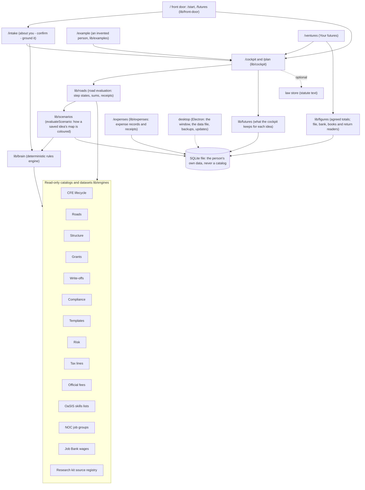

# DotAmi Architecture Overview

Last updated: 2026-10-31 (the layer map, the routes and the folder layout read again from the disk: 12 pages,
every folder under `lib/`, `components/` and `desktop/`; `tests/architecture-docs-paths.spec.ts` fails on a path
here that isn't on disk); 2026-10-24 (the journey draft is held in the window's memory, never its storage);
2026-09-22

## Layer map



## Routes

Every `page.tsx` under `app/` (12 on 2026-10-31). The pages of the journey sit in the route group
`app/(journey)/`, which adds nothing to the address.

| Route | Page | Layer | Key components |
|-------|------|-------|----------------|
| `/` | `app/(journey)/page.tsx` | Front door | `components/discovery/landing-page.tsx` |
| `/start` | `app/(journey)/start/page.tsx` | Front door (*Your destination*) | `components/front-door/destination-page.tsx` |
| `/futures` | `app/(journey)/futures/page.tsx` | Front door (*Pick a future*) | `components/front-door/pick-future-page.tsx` |
| `/example/[id]` | `app/example/[id]/page.tsx` | Cockpit, read-only example | `components/cockpit/cockpit-page-client.tsx` (`ExampleCockpitClient`) |
| `/intake` | `app/(journey)/intake/page.tsx` | Intake | `components/discovery/intake-page.tsx` |
| `/cockpit` | `app/(journey)/cockpit/page.tsx` | Cockpit | `components/cockpit/cockpit-page-client.tsx`, `components/cockpit/cockpit-page.tsx` |
| `/plan` | `app/(journey)/plan/page.tsx` | Cockpit (*Your plan*) | `components/cockpit/plan-page.tsx` |
| `/ventures` | `app/(journey)/ventures/page.tsx` | Ideas (*Your futures*) | `components/ventures/ventures-page.tsx` |
| `/expenses` | `app/(journey)/expenses/page.tsx` | Figures (*Your expenses*) | `components/expenses/expenses-page.tsx` |
| `/settings` | `app/(journey)/settings/page.tsx` | Settings | `components/settings/settings-page.tsx` |
| `/your-data` | `app/(journey)/your-data/page.tsx` | Privacy (*What DotAmi knows about you*) | `components/your-data/your-data-page.tsx` |
| `/licences` | `app/(journey)/licences/page.tsx` | Licences | `components/licences/licences-page.tsx` |

The API routes are under `app/api/`; CLAUDE.md lists them.

## Folder layout

Every folder one level under `lib/`, `components/` and `desktop/` on 2026-10-31, and the engine folders under
`lib/engines/` ([engines.md](engines.md) says what each holds).

```
lib/
  about-job/              # About this job: the picked job's requirements and wages, built on the server
  api/                    # request body limit, rate limit, route error logging
  brain/                  # the deterministic rules engine: predicates, evaluateProfile, risk reads
  cockpit/                # the cockpit's words, folds, plan and "what you've told DotAmi"
  db/                     # the Prisma client (client.ts), scenario JSON, venture load and save
  engines/
    shared/types.ts       # EngineCitation, EngineCatalog, Province
    all-citations.ts      # every catalog's citations in one list
    index.ts              # barrel export
    cfe/v2026/            # lifecycle nodes
    roads/v2026/          # roads: steps, columns, forks
    structure/v2026/      # entity ladder
    grants/v2026/
    writeoffs/v2026/
    compliance/v2026/
    templates/v2026/
    risk/v2026/           # risk reads and combinations
    taxlines/v2026/       # CRA form lines for figure kinds
    fees/v2026/           # official fees
    oasis/v2026/          # the government's skills lists by job (imported, licensed)
    noc/v2021/            # Statistics Canada's job groups (imported, licensed)
    wages/v2026/          # Job Bank's published wages (imported, licensed)
    research-kit/v2026/   # the source registry: each outside source's terms
  examples/               # Mara, the invented example future
  expenses/               # business expense records and their receipt files
  figures/                # agreed totals; readers for files, bank records, books and returns
  format/                 # money and month formatting
  front-door/             # the front door: questions, receipts, futures listed, job search
  futures/                # what the cockpit keeps for each idea (step progress, skill marks, picks)
  http/                   # the allowed-host guard, the launch secret, safe links
  journey/                # the journey draft, held in the window's memory (never its storage)
  landscape/              # others in this line of work: businesses you're watching
  law/                    # a provision's lines from the optional statute store
  licences/               # the third-party notices page's reader
  person/                 # the person's own statements, dated and verbatim
  places/                 # places as international codes, Alberta's areas
  playbook/               # the playbook export
  privacy/                # the privacy inventory, holdings and Delete
  providers/              # the intake parser's model settings
  readout/                # the readout API's shape
  roads/                  # road evaluation: step states, sums, receipts
  scenarios/              # user scenario state, evaluateScenario
  settings/               # the settings catalog and store
  utils/
  ventures/               # Your futures' words

components/
  cockpit/
  discovery/              # the front door (landing-page.tsx) and the intake
  expenses/
  front-door/             # Your destination, Pick a future, the job search
  licences/
  settings/
  shared/                 # journey-provider, citation links, official words
  ui/                     # ui primitives
  ventures/
  your-data/
  node-detail-panel.tsx
  playbook-export-panel.tsx

desktop/                  # the Electron app: main.mjs and its modules (key, encryption, backup, migrate, updates)
```

## State boundaries

- **Engines:** read-only catalogs; never in the database
- **Scenario:** user profile + branch state in SQLite via Prisma
- **Journey draft:** the intake in progress, *Your destination*'s answers and the idea open on the map, held in
  the window's memory only (`lib/journey/held-journey.ts`, through `components/shared/journey-provider.tsx`;
  since 2026-10-24, never the window's storage). A reload, a new window or the desktop app's Go menu starts it
  afresh; each answer reaches the data file where it is kept (`lib/journey/window-storage.ts` says where)
- **Window storage:** how the cockpit was left (`dotami-cockpit-folds`) and nothing about the person
  (`lib/privacy/inventory.ts` `WINDOW_STORAGE`)

## Stack

Next.js 15 App Router (15.5.24+, since 2026-09-20), React 19, TypeScript, Tailwind, Prisma, SQLite (PostgreSQL
until 2026-09-28; the package is better-sqlite3-multiple-ciphers, through `lib/db/client.ts`), and Electron for
the desktop app (`desktop/`).
Self-hosted; no hosting provider is assumed. The optional intake parser is the only model call
(`ANTHROPIC_API_KEY`, off by default). React Flow, dagre and the Lens chat were removed in 2026-09.
